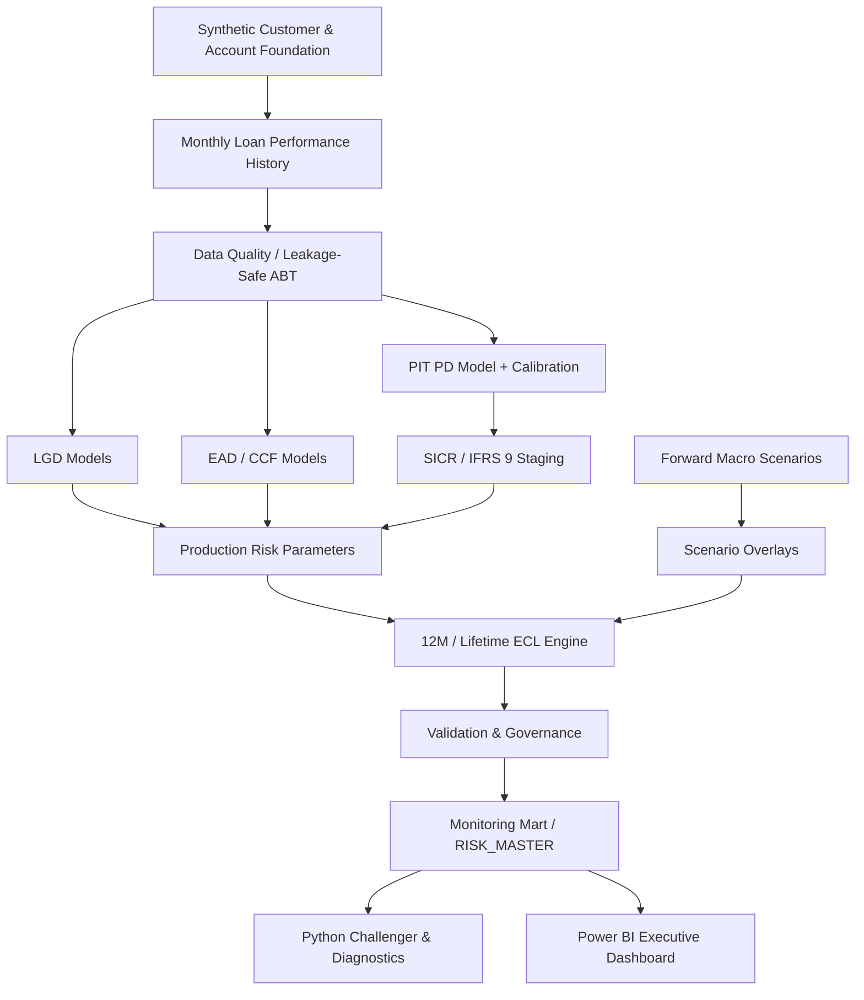

# IFRS 9 Credit Risk & Expected Credit Loss Engine

An end-to-end, **SAS-first IFRS 9 credit-risk platform** covering synthetic portfolio generation, data quality, PIT probability of default (PD), loss given default (LGD), exposure at default / credit conversion factors (EAD/CCF), SICR staging, forward-looking macroeconomic scenarios, 12-month and lifetime expected credit loss (ECL), model validation, production guardrails, a Python challenger, and Power BI management reporting.

> **Portfolio-use project.** Loan-level data are synthetically generated. No bank customer data or proprietary portfolio data are used.

## Headline results

| Metric | Result |
|---|---:|
| Reporting accounts | 14,970 |
| Gross exposure | $129.459M |
| Probability-weighted ECL | $2.919M |
| Portfolio allowance rate | 2.255% |
| Stage 2 exposure share | 5.01% |
| Stage 2 ECL share | 47.53% |
| Downside vs Base ECL | +$857K / +30.7% |
| PIT PD OOT AUC | 0.897 |
| PIT PD calibrated OOT Brier | 0.0294 |
| Python surrogate R² | 0.978 |
| Python aggregate ECL difference | +0.17% |
| Auto LGD guardrail usage | 26.19% |
| Final ECL governance | 5 / 5 PASS |
| Reporting governance | 3 / 3 PASS |

## Architecture



## What makes the project different

The project does not stop at fitting models. It includes:
- leakage-safe time-based development and untouched holdouts,
- calibration and stability diagnostics,
- separate secured and unsecured LGD mechanics,
- horizon-specific revolving CCF and amortizing-term EAD logic,
- SICR/staging with DPD and relative-PD deterioration,
- probability-weighted macro scenarios,
- discounted lifetime ECL cash-flow mechanics,
- production model-risk controls,
- independent Python model-behavior diagnostics,
- management reporting and reconciliation gates.

A key governance example was the **Auto LGD production guardrail**. Production scoring revealed that collateral-coverage values for seasoned performing loans materially exceeded the development-default support. Rather than tuning the model to 2025 ECL, the production input was capped at the **TRAIN 99th percentile (1.9894)** while retaining the raw value for audit. Stage-2 mean Auto LGD moved from **7.14% to 10.83%**, while total portfolio ECL changed by only about **0.11%**.

## Repository layout

```text
.
├── README.md
├── run_all.sas
├── requirements.txt
├── .gitignore
├── sas/
│   ├── 00_setup.sas
│   ├── 01_build_foundation.sas
│   ├── ...
│   ├── 18_validate_monitoring_mart.sas
│   └── diagnostics/
├── python/
│   ├── 19_python_challenger.py
│   └── 20_python_risk_diagnostics.py
├── data/
│   ├── processed/
│   └── external/
├── outputs/
│   └── python/
├── powerbi/
│   ├── BUILD_GUIDE.md
│   ├── DAX_MEASURES.md
│   └── screenshots/
└── docs/
    ├── methodology.md
    ├── model_governance.md
    ├── validation_summary.md
    ├── data_dictionary.md
    └── reproducibility.md
```

## Reproduce the SAS engine

1. Create these SAS OnDemand folders under your home directory:
   - `~/sas`
   - `~/data/raw`
   - `~/data/intermediate`
   - `~/data/model`
   - `~/outputs`
2. Place the SAS files from `sas/` in `~/sas`.
3. Place official macro CSVs named `UNRATE.csv`, `FEDFUNDS.csv`, and `GDP_REAL_GROWTH.csv` in `~/data/raw`.
4. Run `run_all.sas`.

The pipeline is deterministic conditional on the fixed seed and input macro series.

## Python challenger

From the repository root:

```bash
pip install -r requirements.txt
cp data/processed/p8_powerbi_account_fact.csv python/
cd python
python 19_python_challenger.py
python 20_python_risk_diagnostics.py
```

The challenger target is **production weighted ECL**, not future realized loss. Its R² is therefore an explanatory / surrogate-fidelity measure, not predictive accuracy.

## Power BI

The final dashboard has four pages:
1. **Executive Overview**
2. **SICR & Credit Migration**
3. **Scenario & Stress Testing**
4. **Model Risk & Governance**

See `powerbi/BUILD_GUIDE.md` and the screenshots in `powerbi/screenshots/`.

## Important limitations

This is a portfolio / educational system, not a production bank implementation. In particular:
- synthetic loan-level data are used;
- scenario overlay betas are governed assumptions, not estimated causal macro coefficients;
- the Stage 3 population reflects the reporting-date visible/default stock rather than a fully reconstructed workout ledger;
- Stage 3 ECL uses simplified immediate loss mechanics rather than a full discounted workout cash-shortfall model;
- Stage-2 revolving EAD beyond 12 months uses a controlled behavioral-life assumption;
- the Python challenger is an in-sample model-behavior surrogate;
- the PD temporal OOT split uses repeated account-month observations and is not an independent borrower holdout.

See `docs/model_governance.md` for the full limitation register.

## Technologies

**SAS / PROC SQL / PROC LOGISTIC / PROC GLM / PROC PLM · Python · pandas · scikit-learn · Power BI · DAX**

