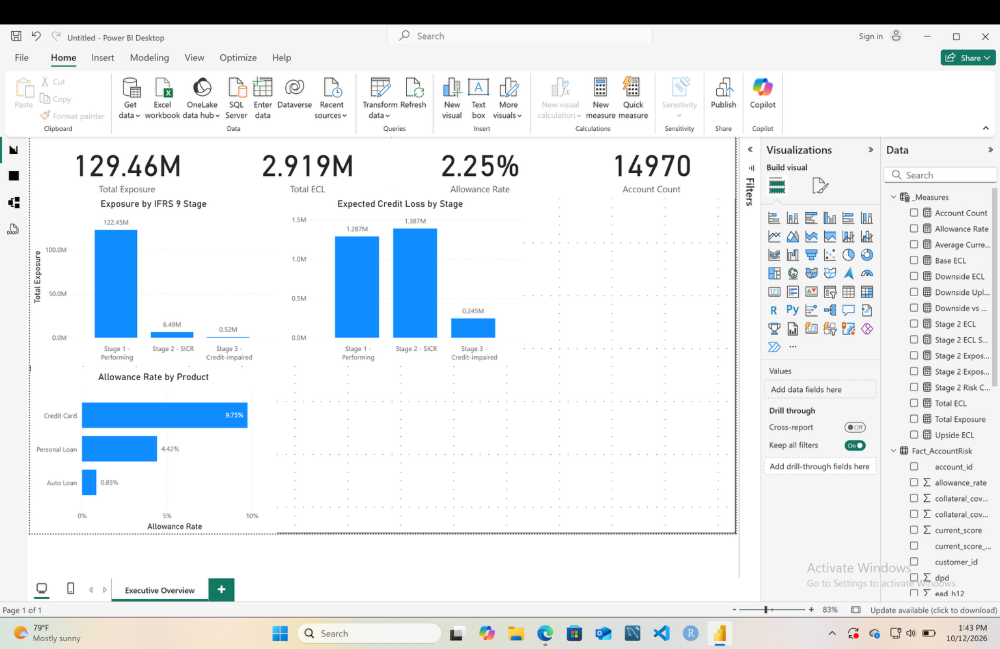
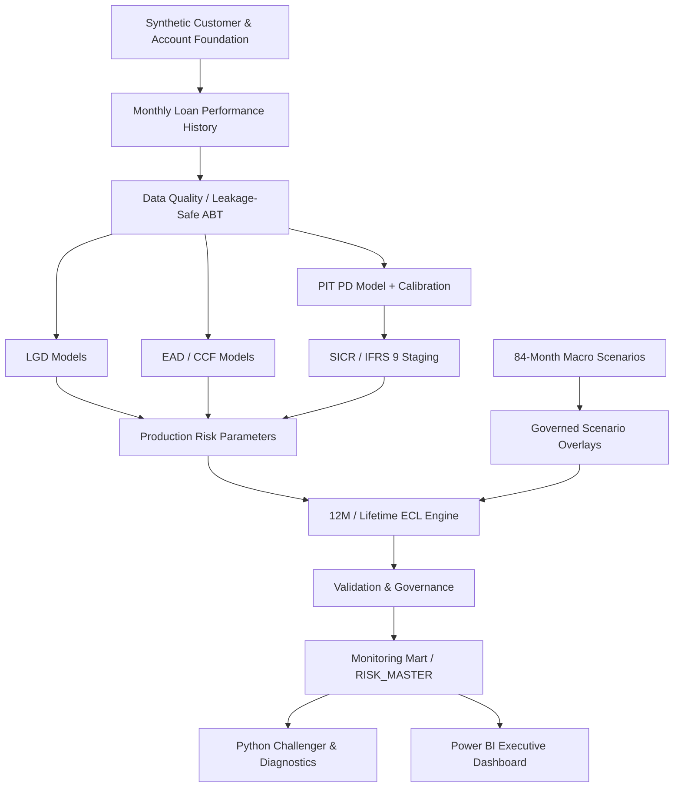
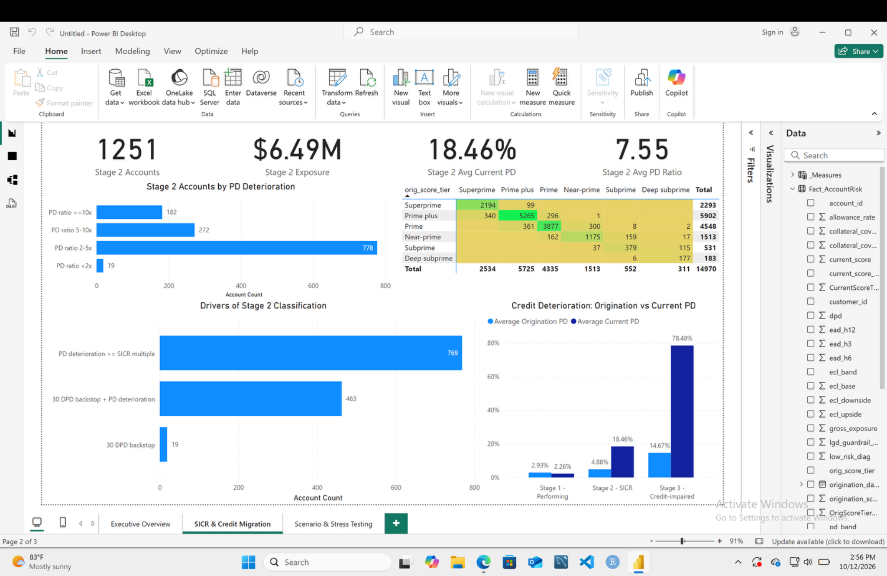
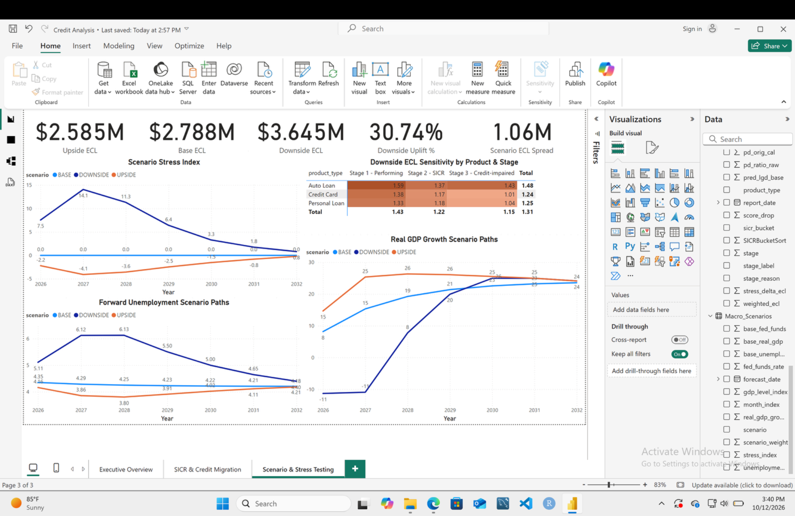
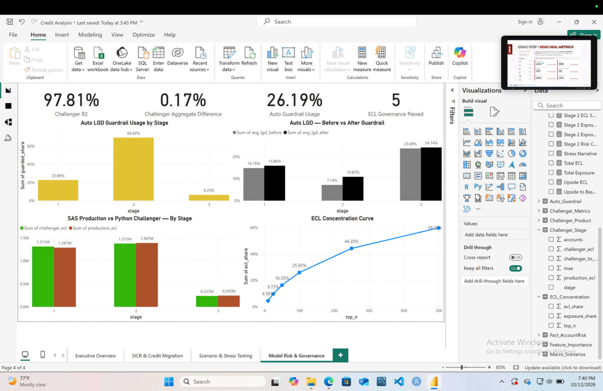

# IFRS 9 Credit Risk & Expected Credit Loss Engine

**SAS-first credit-risk modeling, lifetime ECL, model governance, Python challenger analytics, and Power BI reporting.**

This project builds an end-to-end IFRS 9-style retail credit-risk workflow across **14,970 synthetic reporting accounts** and **$129.46M of gross exposure**. It covers portfolio construction, PIT PD, LGD, EAD/CCF, SICR staging, forward-looking macro scenarios, discounted 12-month / lifetime ECL, validation, production guardrails, monitoring, an independent Python challenger, and executive Power BI reporting.

> **Portfolio project:** all loan-level customer/account data are synthetic. No bank customer data or proprietary portfolio data are used.

<p align="center">
  
</p>

## Executive results

| Metric | Result |
|---|---:|
| Reporting accounts | **14,970** |
| Gross exposure | **$129.459M** |
| Probability-weighted ECL | **$2.919M** |
| Portfolio allowance rate | **2.255%** |
| Stage 2 exposure share | **5.01%** |
| Stage 2 ECL share | **47.53%** |
| Downside vs Base ECL | **+$857K / +30.7%** |
| PIT PD OOT AUC | **0.897** |
| PIT PD calibrated OOT Brier | **0.0294** |
| EAD / CCF governance | **9 / 9 PASS** |
| Final ECL governance | **5 / 5 PASS** |
| Monitoring reconciliation | **3 / 3 PASS** |
| Python challenger R² | **0.978** |
| Python aggregate ECL difference | **+0.17%** |
| Auto LGD production guardrail usage | **26.19%** |

## Why this project matters

The project is designed around the parts of credit-risk work that are often missing from modeling demos:

- **Leakage-safe model development** with time-based TRAIN / VALID / TEST governance.
- **Model-specific validation** for PD, LGD, and EAD/CCF rather than one generic score.
- **SICR and staging logic** connecting origination risk, current risk, and delinquency.
- **Forward-looking scenarios** with Base / Upside / Downside macro paths.
- **Monthly lifetime ECL mechanics** with survival, marginal PD, EAD, LGD, and EIR discounting.
- **Production model-risk controls** when live scoring leaves development support.
- **Independent challenger analytics** in Python without replacing the frozen SAS engine.
- **Management reporting** that reconciles exactly back to the production risk master.

## Architecture



## Modeling highlights

### PIT Probability of Default

A 12-month forward target is created with the leakage-safe convention:

```text
X_t  ->  default during t+1 ... t+12
```

The final logistic champion was developed and validated through temporal splits. An exact DPD-feature collinearity was identified and removed before freeze.

| Validation window | AUC | Brier / calibration note |
|---|---:|---|
| TRAIN | 0.9089 | Mean PD matched observed default rate |
| VALID | 0.9012 | Used for calibration only |
| TEST | **0.8972** | Calibrated Brier **0.0294** |

The TEST set was not used for tuning.

### Loss Given Default

The LGD architecture separates:
- **secured Auto loans**, using collateral-sensitive severity modeling;
- **unsecured Credit Card / Personal loans**, using a hurdle structure for recovery incidence and severity.

On the untouched test set, the champion produced:
- overall RMSE: **0.0688**
- overall MAE: **0.0512**
- predicted mean LGD: **76.23%**
- observed mean LGD: **76.72%**

### Exposure at Default / CCF

The first long-horizon EAD specification was **rejected** after holdout testing showed unstable extrapolation and collinearity.

The production repair uses:
- Card 3M: parsimonious CCF regression;
- Card 6M / 12M: stable development mean CCF;
- Auto / Personal 3M / 6M / 12M: stable product × horizon development EAD ratios.

The final governance reset produced **9 / 9 PASS** across product × horizon checks.

## SICR and IFRS 9 staging

Final report-date population:

| Stage | Accounts | Exposure | Exposure share | Weighted ECL | ECL share |
|---|---:|---:|---:|---:|---:|
| Stage 1 | 13,658 | $122.45M | 94.59% | $1.287M | 44.08% |
| Stage 2 | 1,251 | $6.49M | **5.01%** | $1.387M | **47.53%** |
| Stage 3 | 61 | $0.52M | 0.40% | $0.245M | 8.39% |

The key management finding is that **Stage 2 represents only 5.0% of exposure but 47.5% of total ECL**.

<p align="center">
  
</p>

## Forward-looking scenario ECL

The engine uses three 84-month macro scenarios:

| Scenario | Weight | Portfolio ECL |
|---|---:|---:|
| Upside | 20% | $2.585M |
| Base | 60% | $2.788M |
| Downside | 20% | $3.645M |

Downside conditions increase ECL by approximately **$857K / 30.7% versus Base**.

<p align="center">
  
</p>

## Production model-risk case study: Auto LGD

Production deployment review identified a real model-risk problem: current collateral coverage for seasoned Auto loans materially exceeded the support observed among TRAIN defaults.

Development support:
- TRAIN collateral-coverage P95: **1.3212**
- TRAIN P99: **1.9894**
- TRAIN max: **2.0752**

Production diagnostics:
- Auto accounts: **5,220**
- Guardrailed accounts: **1,367**
- Guardrail usage: **26.19%**
- Stage-2 Auto guardrail usage: **69.42%**

Rather than refitting the LGD model to final portfolio ECL, production scoring applies a **TRAIN-P99 cap to the model input** while preserving raw collateral coverage for audit.

Stage-2 Auto mean LGD moved from:

```text
7.14%  ->  10.83%
```

while total portfolio ECL changed by only about **0.11%**.

That distinction matters: the control fixes **out-of-support scoring**, not the allowance target.

## Independent Python challenger

The SAS engine remains the production system of record. Python is used only as an independent model-behavior challenger and diagnostic layer.

Final challenger metrics:
- R²: **0.9781**
- MAE: **$19.51**
- RMSE: **$115.66**
- aggregate challenger / production ECL: **1.0017**
- aggregate difference: **+0.17%**

Segment reconciliation remained within roughly ±4% across products and ±3% across IFRS 9 stages.

Permutation importance ranked the production drivers in economically coherent order:

```text
Current calibrated PD
-> Production LGD
-> 12M EAD
-> Gross exposure
-> 6M / 3M EAD
-> Stage
-> PD deterioration
-> DPD
```

> The 0.978 R² is **surrogate/explanatory fidelity**, not realized-loss predictive accuracy.

## ECL concentration

The loss allowance is materially more concentrated than exposure:

| Top accounts by ECL | Share of total ECL |
|---:|---:|
| 10 | 4.56% |
| 25 | 9.73% |
| 50 | 16.35% |
| 100 | 25.95% |
| 250 | 44.20% |
| 500 | **59.72%** |

Only **3.34% of accounts (Top 500)** contribute almost **60% of total ECL**.

<p align="center">
  
</p>

## Repository structure

```text
.
├── README.md
├── run_all.sas
├── requirements.txt
├── .gitignore
│
├── sas/
│   ├── 00_setup.sas
│   ├── 01_build_foundation.sas
│   ├── ...
│   ├── 18_validate_monitoring_mart.sas
│   └── diagnostics/
│
├── python/
│   ├── 19_python_challenger.py
│   └── 20_python_risk_diagnostics.py
│
├── data/
│   ├── processed/
│   └── external/
│
├── outputs/
│   ├── validation_summary.csv
│   └── python/
│
├── powerbi/
│   ├── BUILD_GUIDE.md
│   ├── DAX_MEASURES.md
│   └── screenshots/
│
└── docs/
    ├── methodology.md
    ├── model_governance.md
    ├── validation_summary.md
    ├── data_dictionary.md
    ├── reproducibility.md
    └── resume_snippets.md
```

## Reproduce the SAS engine

Create the following folders under your SAS OnDemand home directory:

```text
~/sas
~/data/raw
~/data/intermediate
~/data/model
~/outputs
```

Place the repository SAS scripts in `~/sas/`, add the official macro CSV inputs to `~/data/raw/`, then run:

```sas
%include "%sysget(HOME)/sas/run_all.sas";
```

Or run the repository-level `run_all.sas` after copying it to the SAS home environment.

Expected macro inputs:
- `UNRATE.csv`
- `FEDFUNDS.csv`
- `GDP_REAL_GROWTH.csv`

See [`docs/reproducibility.md`](docs/reproducibility.md) for details.

## Run the Python challenger

```bash
pip install -r requirements.txt
cp data/processed/p8_powerbi_account_fact.csv python/
cd python
python 19_python_challenger.py
python 20_python_risk_diagnostics.py
```

The generated diagnostics are written to `python/python_outputs/`.

## Rebuild the Power BI dashboard

Use the processed reporting exports in `data/processed/`.

The dashboard contains four pages:
1. **Executive Overview**
2. **SICR & Credit Migration**
3. **Scenario & Stress Testing**
4. **Model Risk & Governance**

See:
- [`powerbi/BUILD_GUIDE.md`](powerbi/BUILD_GUIDE.md)
- [`powerbi/DAX_MEASURES.md`](powerbi/DAX_MEASURES.md)

## Governance and limitations

This is a portfolio / educational implementation, not a production bank IFRS 9 system.

Important limitations include:
- synthetic loan-level data;
- governed scenario overlay betas rather than estimated causal macro elasticities;
- reporting-date Stage 3 visibility rather than a fully reconstructed workout-stock ledger;
- simplified Stage-3 immediate-loss mechanics rather than full discounted workout cash shortfalls;
- controlled long-horizon revolving EAD assumptions after 12 months;
- a relative-PD SICR proxy rather than a bank-specific lifetime-SICR framework;
- repeated account-month observations in temporal PD validation;
- an in-sample Python surrogate whose purpose is explainability, not loss forecasting.

See [`docs/model_governance.md`](docs/model_governance.md) for the full limitation register.

## Technology stack

**SAS · PROC SQL · PROC LOGISTIC · PROC GLM · PROC PLM · Python · pandas · NumPy · scikit-learn · Power BI · DAX**

---

### Project positioning

This repository is intended to demonstrate an analyst workflow that connects **credit-risk modeling, model validation, production controls, scenario ECL, and management reporting** rather than optimizing a single model metric.
